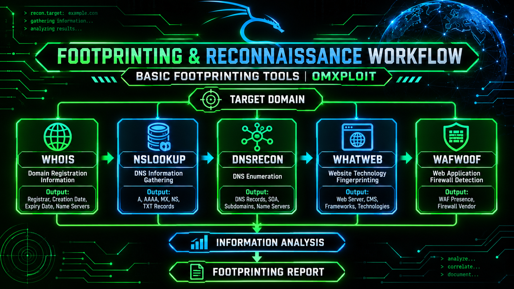
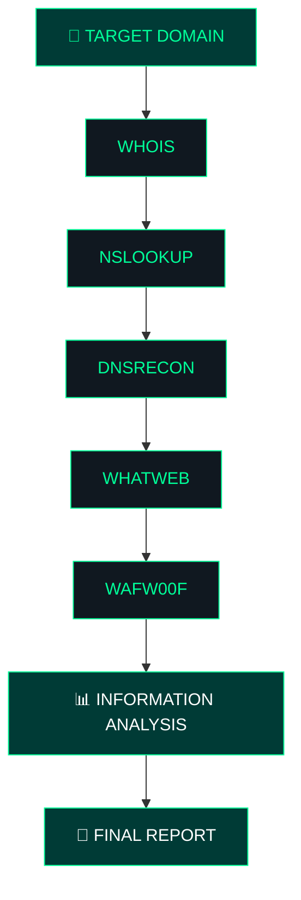
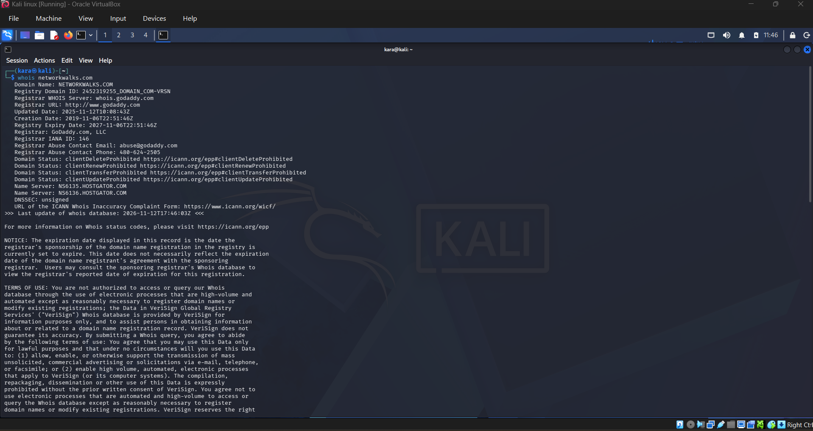
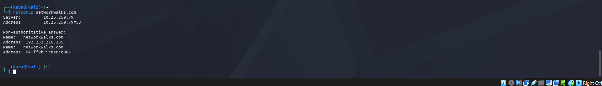
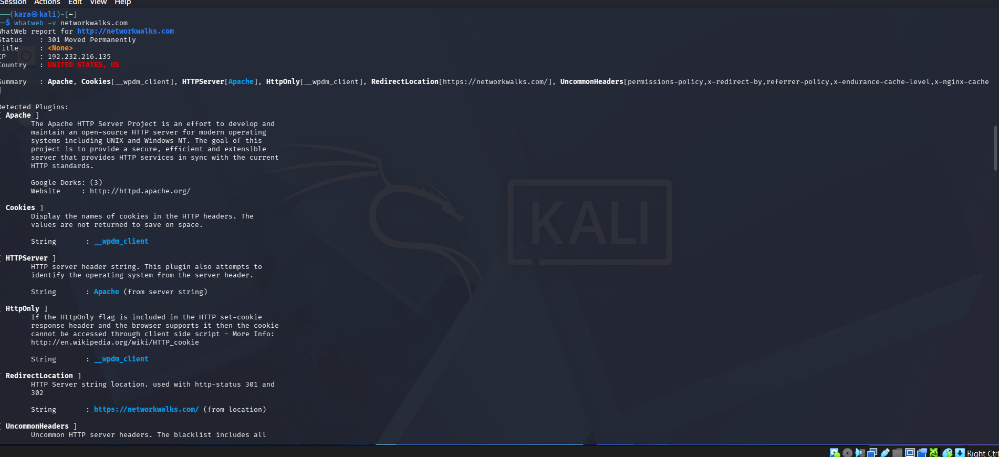
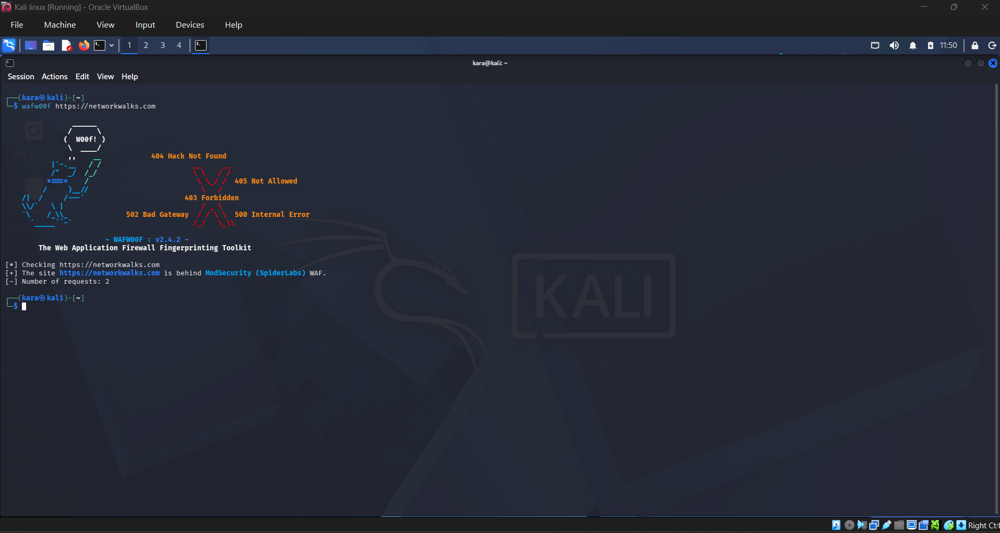
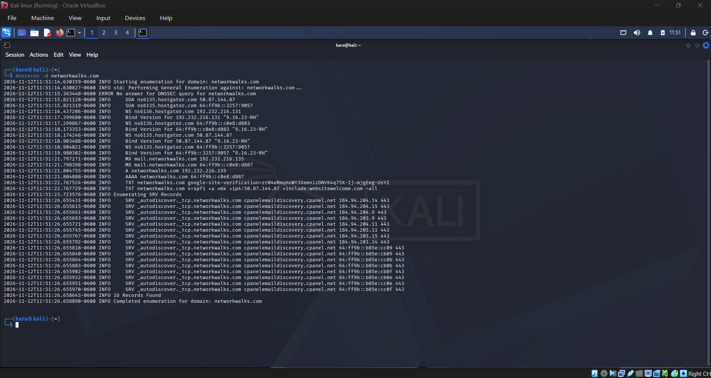

# 🔐 BASIC FOOTPRINTING TOOLS

<div align="center">


<br/>


</div>

---

## 🧬 01. ABOUT THE PROJECT

> **"Every successful security assessment begins with information gathering."**

Basic Footprinting is a beginner-level cybersecurity project focused on understanding the fundamentals of information gathering and reconnaissance.

Footprinting is an initial phase of ethical hacking in which publicly available information about a target domain, website, DNS infrastructure, IP addresses, and web technologies is collected and analyzed.

This project explores five fundamental footprinting tools through practical implementation in Kali Linux.

### 🎯 Project Goals

- Understand the fundamentals of website footprinting.
- Collect publicly available domain information.
- Identify DNS records and IP addresses.
- Discover website technologies and frameworks.
- Detect Web Application Firewalls.
- Perform basic DNS enumeration.
- Develop practical reconnaissance skills.

---

## ⚡ 02. FOOTPRINTING WORKFLOW

<div align="center">



</div>

### 🔄 Reconnaissance Process



---

## 🛠️ 03. TOOLS & TECHNOLOGIES

<div align="center">

| # | Tool | Primary Purpose |
|:---:|:---:|:---|
| 01 | WHOIS | Domain Information Gathering |
| 02 | NSLookup | DNS Information Gathering |
| 03 | WhatWeb | Website Technology Fingerprinting |
| 04 | WAFW00F | Web Application Firewall Detection |
| 05 | DNSRecon | DNS Enumeration |

</div>

---

## 🔍 04. WHOIS — DOMAIN INFORMATION GATHERING


**What is WHOIS?**

WHOIS is a domain lookup tool used to gather publicly available domain registration information.

**Key Information:**
- Domain registrar
- Domain creation date
- Domain expiration date
- Name servers
- Domain status
- Public registrant information (if available)

**Command:**

```bash
whois networkwalks.com
```

**📸 Practical Output**



---

## 🌐 05. NSLOOKUP — DNS INFORMATION GATHERING


**What is NSLookup?**

NSLookup is a command-line utility used to query DNS servers and retrieve information about domain names.

**Key Information:**
- A Records
- AAAA Records
- MX Records
- NS Records
- TXT Records

**Commands:**

```bash
nslookup networkwalks.com

nslookup -type=A networkwalks.com

nslookup -type=MX networkwalks.com

nslookup -type=NS networkwalks.com

nslookup -type=TXT networkwalks.com
```

**📸 Practical Output**



---

## 🕸️ 06. WHATWEB — WEBSITE FINGERPRINTING


**What is WhatWeb?**

WhatWeb is a website fingerprinting tool used to identify technologies and software running on a website.

**Key Information:**
- Web server information
- CMS detection
- Programming technologies
- JavaScript libraries
- Frameworks
- HTTP headers

**Commands:**

```bash
whatweb https://networkwalks.com
```

Aggressive scan:

```bash
whatweb -a 3 https://networkwalks.com
```

**📸 Practical Output**



---

## 🛡️ 07. WAFW00F — FIREWALL DETECTION


**What is WAFW00F?**

WAFW00F is a web application firewall fingerprinting tool used to identify whether a website is protected by a Web Application Firewall.

**Key Information:**
- WAF presence
- Possible firewall vendor
- Firewall fingerprint
- Detection results

**Commands:**

```bash
wafw00f https://networkwalks.com
```

Verbose output:

```bash
wafw00f -v https://networkwalks.com
```

**📸 Practical Output**



---

## 🔬 08. DNSRECON — DNS ENUMERATION


**What is DNSRecon?**

DNSRecon is a DNS reconnaissance and enumeration tool used to collect information about a domain's DNS infrastructure.

**Key Information:**
- DNS records
- Name servers
- Mail exchange records
- TXT records
- SOA records
- Subdomain information
- Zone transfer results (if permitted)

**Commands:**

```bash
dnsrecon -d networkwalks.com
```

Standard enumeration:

```bash
dnsrecon -d networkwalks.com -t std
```

Zone transfer check:

```bash
dnsrecon -d networkwalks.com -t axfr
```

**📸 Practical Output**



---

## 💻 09. INSTALLATION — KALI LINUX

Update package repositories:

```bash
sudo apt update
```

Install all required tools:

```bash
sudo apt install whois dnsutils whatweb wafw00f dnsrecon -y
```

Verify installation:

```bash
whois --version
nslookup -help
whatweb --version
wafw00f --version
dnsrecon -h
```

---

## 📊 10. TOOLS COMPARISON

| Tool | Category | Main Function |
|---|---|---|
| WHOIS | Domain Recon | Registration Details |
| NSLookup | DNS Recon | DNS Queries |
| WhatWeb | Web Recon | Technology Detection |
| WAFW00F | Web Security | WAF Detection |
| DNSRecon | DNS Recon | DNS Enumeration |

---

## 🧠 11. KEY LEARNINGS

Through this project, I learned:

- Fundamentals of information gathering and footprinting.
- Domain registration lookup techniques.
- DNS records and domain resolution.
- Website technology fingerprinting.
- Web Application Firewall detection.
- DNS enumeration and reconnaissance.
- Practical usage of cybersecurity tools in Kali Linux.

---

## 🚀 12. FUTURE LEARNING GOALS

My next learning targets:

- Subfinder
- Amass
- theHarvester
- Shodan
- Maltego
- Nmap
- Advanced DNS Enumeration

---

## ⚖️ 13. DISCLAIMER

This project is created strictly for educational purposes and ethical cybersecurity learning.

All tools must only be used on systems and domains owned by you or for which you have explicit authorization.

Unauthorized scanning, testing, or information gathering is not encouraged.

---

## 👨‍💻 14. AUTHOR

<div align="center">


**Cybersecurity Enthusiast | Ethical Hacking Learner**

Learning • Practicing • Exploring Cybersecurity


</div>

---

<div align="center">

### ⭐ LEARN • PRACTICE • SECURE


</div>
